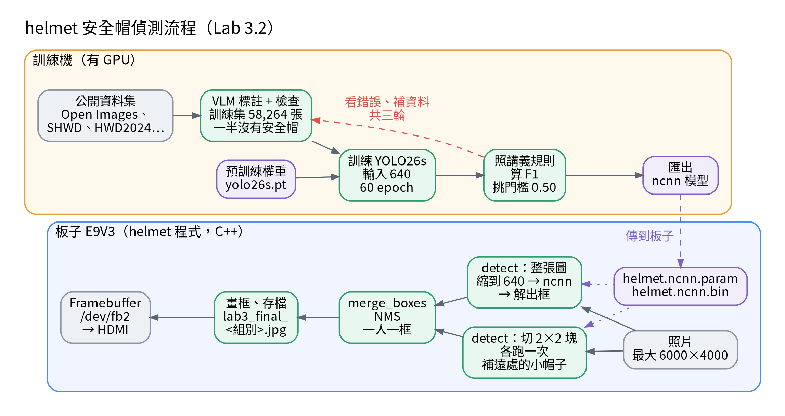
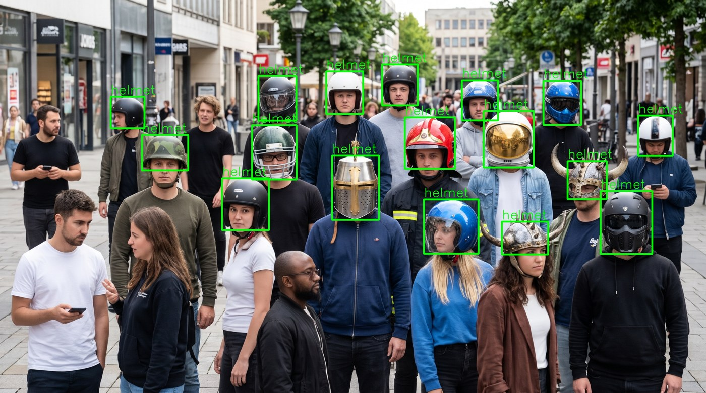

# Lab3-2



## 總覽

題目是給一張照片（最大 6000×4000），把有戴安全帽的人框出來，存成 `lab3_final_<組別>.jpg` 並顯示在 HDMI，用 F1 計分。框到沒戴安全帽的人、框到背景、同一個人框兩次都算錯。

我們的作法分成兩邊：**訓練機負責整理資料、訓練模型、匯出模型，板子只負責跑模型**。資料集、訓練和評估的程式不在 repo 裡，repo 只放板子上的程式。

| 階段 | 在哪裡做 | 做什麼 | 產出 |
| --- | --- | --- | --- |
| 1 資料集 | 訓練機 | 把公開資料集轉成同一種標法 | 訓練集、驗證集、測試集 |
| 2 訓練 | 訓練機 | 從預訓練權重訓練 YOLO26s | `last.pt` |
| 3 評估 | 訓練機 | 照講義的規則算 F1，挑信心門檻 | 門檻 0.50 |
| 4 匯出 | 訓練機 | 轉成 ncnn 格式 | `helmet.ncnn.param`、`helmet.ncnn.bin` |
| 5 偵測 | 板子 | 讀照片、跑模型、畫框、存檔、顯示 | `lab3_final_<組別>.jpg` |

板子的 OpenCV 3.4.7 沒有 dnn 模組，Python 也沒有 cv2，所以模型用 ncnn 跑（和 3.1 用同一份 ncnn），讀圖、縮放、畫框、存檔才用 OpenCV。

板子上程式的順序（`lab3/helmet/src/main.cpp:45-110`）：

```
讀 config.yml → 載入模型 → imread → find_helmets → draw_boxes → imwrite → sync → fb.show → 等 Enter
```

所有參數都在 `config.yml`，改完重跑就好，不用重新編譯。

---

## 1. 資料集

模型只學一個類別 `helmet_worn`：戴在頭上的安全帽。只要是保護頭部、而且真的戴在頭上的都算，例如工地安全帽、機車和自行車安全帽、運動頭盔、消防和軍用頭盔。框只框帽子本身，不含臉和脖子；一頂戴著的帽子就代表一個戴安全帽的人。

沒戴帽子的人、拿在手上或放在桌上的安全帽、棒球帽和毛帽這類一般帽子都不框。這些圖我們也收進訓練集，當成「沒有東西要框」的例子，模型才學得會不去框。

訓練集共 58,264 張，其中 29,366 張有安全帽（50,187 個框），另外 28,898 張沒有。

| 內容 | 來源 | 張數 |
| --- | --- | ---: |
| 基礎集：各類頭盔和沒有頭盔的圖 | Open Images、HelmetML（機車）、SHEL5K（工地）等 | 20,106 |
| 工地、工廠 | SHWD、HWD2024、SFCHD | 9,965 |
| 機車騎士 | HELMET（緬甸）、EdgeVision（印度） | 3,771 |
| 運動、軍用、馬術、消防等頭盔 | Open Images、COCO / LVIS | 7,210 |
| 戴一般帽子的人 | Open Images、COCO / LVIS | 7,256 |
| 容易看錯的場景（大多沒有頭盔） | Open Images 的運動和戶外人像、COCO 一般人像 | 9,956 |

SHWD、HWD2024、SFCHD 沒有寫明圖片的授權，我們只拿來做這份作業。

**標註的作法**：每個資料集原本的標法都不一樣，有的框整顆頭，有的連臉一起框，有的只標「這張圖有頭盔」。我們在訓練機上跑視覺語言模型（VLM，Qwen），全部轉成同一種標法：

- 原本就有頭盔框（Open Images）：用 VLM 看每個框是不是戴在真人頭上，再把框縮到帽子的大小。
- 沒有框：VLM 先把帽子框出來，再一個一個確認有戴。
- 框的是整顆頭或連臉一起框（SHWD、EdgeVision）：把框裁出來放大，用 VLM 重新框帽子。
- 原本就框帽子（HWD2024、SFCHD、SHEL5K）：帽子的框要和標註的頭重疊才算有戴，對不上的圖不用。

基礎集是最早整理的一批，框主要由 VLM 產生，再用同一個 VLM 複查一次。之後加的來源，會先用先前訓練出來的偵測模型掃一遍，找出可能漏標的圖；再抽大約 36 張，把框畫在圖上看，錯誤率在 10% 以下才收；最後去掉重複的圖，和驗證集、測試集重複的也不收。這些標註來自 VLM 和資料集的發布者，沒有經過人工確認，抽查也只是用來決定一個來源要不要收。

驗證集和測試集都不參與訓練。標註的來源和訓練集一樣，也沒有人工確認：

| 組 | 張數 | 內容 | 用途 |
| --- | ---: | --- | --- |
| `val` | 503 | 多數是運動和其他防護頭盔，少數工地和機車 | 一般情況 |
| `eval_hwd2024` | 1,357 | 工地照片，約一半是大圖 | 工地和大圖的情況 |
| `eval_hats` | 441 | 戴一般帽子的人（只有 2 頂安全帽） | 看會不會把一般帽子框進來 |
| `eval_oi` | 260 | 運動、軍用、馬術頭盔 | 看工地以外的頭盔有沒有漏 |
| `test` | 557 | 和 `val` 同一批切出來 | 最後確認 |

---

## 2. 訓練

模型用 YOLO26s，輸入 640×640。講義給 20 分鐘，速度不是問題，所以不用最小的 YOLO26n，改用比較準的 s。照片裡的帽子常常很小，輸入也選比較大的 640。

訓練用 Ultralytics，步驟是：

1. 載入官方的預訓練權重 `yolo26s.pt`（在 COCO 的 80 個類別上訓練過），把類別數改成 1。
2. 整個網路一起訓練 60 個 epoch，沒有凍結任何一層。沒有安全帽的圖用空的標註檔，一樣放進去訓練。
3. 每個 epoch 結束，在 `val` 加 `eval_hwd2024` 上算一次 mAP。
4. 訓練完用最後一個 epoch 的權重 `last.pt`。驗證分數從第 36 個 epoch 起就差不多了，分數最高的 epoch 和最後一個只差 0.001，所以沒有另外挑。

```python
from ultralytics import YOLO

model = YOLO('yolo26s.pt')                 # COCO 預訓練權重
model.train(
    data='data_lab3.yaml',                 # 訓練清單、驗證清單、類別數 1
    imgsz=640, epochs=60, batch=12,
    optimizer='AdamW', lr0=0.001, cos_lr=True,
    close_mosaic=10,                       # 最後 10 個 epoch 關 mosaic
    amp=True, seed=20261031,
)
```

| 項目 | 設定 |
| --- | --- |
| 優化器 | AdamW，學習率 0.001，前 3 個 epoch 慢慢升上去，之後照 cosine 曲線降到約 1% |
| 資料增強 | mosaic（4 張圖拼成 1 張）、隨機縮放和平移、色彩抖動、左右翻轉；最後 10 個 epoch 關掉 mosaic |
| 硬體和時間 | 一張 NVIDIA RTX PRO 6000 Blackwell，最後一輪訓練 3 小時 |

訓練結束時，這兩組上的 mAP50 是 0.983，mAP50-95 是 0.803。

我們前後訓練了三輪，設定都一樣，每一輪都從同一份預訓練權重開始，只有資料不同。每訓練完一輪，就照講義的規則算 F1（第 3 節），把框錯和漏掉的地方裁出來看，再補對應的資料：

| 輪 | 訓練張數 | 上一輪的問題 → 這一輪補的資料 | 當時的結果 |
| --- | ---: | --- | --- |
| 1 | 33,617 | 從基礎集加上工地、機車等來源開始 | 工地照片 F1 0.973，但戴一般帽子的那組照片多框了 208 個 |
| 2 | 50,985 | 一般帽子被當成安全帽 → 加入戴一般帽子的人、容易看錯的場景 | 多框的從 208 個降到 10 個；但棒球打擊頭盔、馬術帽這種長得像帽子的頭盔開始漏掉 |
| 3 | 58,264 | 漏掉運動和軍用頭盔 → 主要加入 Open Images 原本就有框的各類頭盔 | 運動和軍用頭盔那一組 F1 從 0.852 升到 0.910，工地照片差不多，一般帽子多框 12 個 |

表裡第 1 輪的信心門檻是 0.55，第 2、3 輪是 0.50。三輪的 mAP 幾乎一樣，這些問題從 mAP 看不出來，要照講義的規則算 F1、把錯的框拿出來看才看得到。test 的 F1 三輪也差不多（0.955、0.951、0.948）。

---

## 3. 評估與信心門檻

demo 的計分方式不是 mAP，所以我們照講義的規則另外寫了評估程式：每個戴安全帽的人最多算一個 TP；多出來的框、框到沒戴的人或背景算 FP；漏掉的算 FN。預測的框和標註的框 IoU（交集 ÷ 聯集）在 0.5 以上才算框對（0.5 是我們自己定的）。評估時跑的流程和板子上一樣（整張圖加切塊，再合併）。

信心門檻用四組驗證集從 0.15 試到 0.75。F1 在 0.35 到 0.55 之間差不多，其中 0.50 時工地照片比低門檻好，一般帽子多框的也比較少，所以用 0.50。測試集沒有拿來挑門檻。

下表是最後的結果，用的是第 3 輪的模型再調過一個數值，調法寫在表的後面：

| 資料 | 張數 | TP / FP / FN | F1 |
| --- | ---: | --- | ---: |
| `test` | 557 | 671 / 27 / 35 | 0.956 |
| 驗證集四組合併 | 2,561 | 2,675 / 146 / 104 | 0.955 |
| `eval_hwd2024`（工地） | 1,357 | 1,606 / 93 / 12 | 0.968 |
| `eval_oi`（運動、軍用頭盔） | 260 | 445 / 20 / 54 | 0.923 |
| `eval_hats`（一般帽子） | 441 | 1 / 15 / 1 | — |

`eval_hats` 的 441 張裡只有 2 頂安全帽，算 F1 沒有意義，只看多框了幾個：15 個。

調的是這個：模型有三個輸出尺度，格子越細的負責越小的帽子。我們試著把每個尺度的分數調高，再到驗證集上重算 F1，只有中間的尺度有明顯幫助，所以把它分類輸出的 bias 加了 0.75，沒有重新訓練。門檻 0.50 下 test 的 F1 從 0.948 變成 0.956。這個調整的效果和把門檻放低差不多：不調、把門檻降到 0.35，test 也有 0.955。

---

## 4. 匯出模型

`last.pt` 用 Ultralytics 匯出成 ncnn 格式，板子上就用這兩個檔案：

```python
YOLO('last.pt').export(format='ncnn', imgsz=640, half=True, device='cpu')
```

- `helmet.ncnn.param`：網路結構（文字檔）。
- `helmet.ncnn.bin`：權重。`half=True` 把權重存成 16 位元浮點數，檔案只有 19 MB，載入時再轉回 32 位元。

模型的輸出是一張 5×8400 的表，每一欄是一個候選框 `(cx, cy, w, h, score)`。同一頂帽子會有好幾個候選框，所以還要去掉重複的框，這一步我們在板子的程式裡自己做（第 5c 節）。

匯出之後確認過兩件事：同一批測試圖用 ncnn 和評估用的 ONNX 格式跑，TP / FP / FN 完全一樣；調整前的 ncnn 模型在板子和訓練機各跑四張圖，框差在 0.1 px 以內。

---

## 5. 板子上的偵測

板子上的程式叫 `helmet`，原始碼在 `lab3/helmet/src/`。主要的工作都在 `HelmetDetector` 裡：`detect()` 跑一次模型，`find_helmets()` 決定要跑幾次、怎麼合併。

### 5a. 跑一次模型（detect）

模型的輸入固定是 640×640。照片先等比例縮放，不夠的地方補灰色，這樣人不會被壓扁。接著把 BGR 轉成 RGB、像素值除以 255，丟進 ncnn。

```cpp
// lab3/helmet/src/helmet_detector.cpp:30-47
// letterbox：等比例縮放後補灰邊（114）成 S x S，和訓練時一樣，人不會被壓扁
double r = std::min ( (double) S / bgr.cols, (double) S / bgr.rows );
int nw = (int) std::lround ( bgr.cols * r );
int nh = (int) std::lround ( bgr.rows * r );
int px = ( S - nw ) / 2, py = ( S - nh ) / 2;
cv::Mat padded ( S, S, CV_8UC3, cv::Scalar ( 114, 114, 114 ) );
cv::resize ( bgr, padded ( cv::Rect ( px, py, nw, nh ) ), cv::Size ( nw, nh ), 0, 0, cv::INTER_AREA );

// BGR → RGB，像素值 0~255 → 0~1
ncnn::Mat in = ncnn::Mat::from_pixels ( padded.data, ncnn::Mat::PIXEL_BGR2RGB, S, S );
const float mean[3] = { 0.f, 0.f, 0.f };
const float norm[3] = { 1 / 255.f, 1 / 255.f, 1 / 255.f };
in.substract_mean_normalize ( mean, norm );

ncnn::Extractor ex = net.create_extractor ( );
ex.input ( cfg.input_blob.c_str ( ), in );
ncnn::Mat out;
ex.extract ( cfg.output_blob.c_str ( ), out );
```

模型吐出 8400 個候選框。分數低於門檻的丟掉，留下來的把座標換回原圖：先扣掉補的灰邊，再除以縮放比。

```cpp
// lab3/helmet/src/helmet_detector.cpp:57-69
const float *cx = out.row ( 0 ), *cy = out.row ( 1 ), *bw = out.row ( 2 ), *bh = out.row ( 3 ), *score = out.row ( 4 );
for ( int i = 0; i < out.w; i++ )
{
    if ( score[i] < cfg.conf_threshold ) continue;
    // 換回原圖座標：先扣掉補邊，再除以縮放比
    Box b;
    b.x1 = (float) ( ( cx[i] - bw[i] / 2 - px ) / r );
    b.y1 = (float) ( ( cy[i] - bh[i] / 2 - py ) / r );
    b.x2 = (float) ( ( cx[i] + bw[i] / 2 - px ) / r );
    b.y2 = (float) ( ( cy[i] + bh[i] / 2 - py ) / r );
    b.score = score[i];
    boxes.push_back ( b );
}
```

### 5b. 大圖再切塊（find_helmets）

整張圖先跑一次。如果照片的短邊在 1280 以上，再切成 2×2 塊（相鄰兩塊重疊 20%），每一塊各跑一次，所以大圖總共跑 5 次。

```cpp
// lab3/helmet/src/helmet_detector.cpp:81-106（節錄）
const int n = cfg.tile_grid;
if ( n >= 2 && std::min ( w, h ) >= n * cfg.input_size )
{
    // 整張圖縮到模型輸入的比例：切塊只補整張圖裡太小（< tile_max_box px）的帽子，大的整張圖已經抓得到
    const double r = std::min ( (double) cfg.input_size / w, (double) cfg.input_size / h );
    std::vector<cv::Rect> tiles = make_tiles ( w, h, n, cfg.tile_overlap );
    for ( size_t t = 0; t < tiles.size ( ); t++ )
    {
        const cv::Rect &tile = tiles[t];
        std::vector<Box> found = detect ( bgr ( tile ) );   // 座標是切塊內的座標
        for ( size_t k = 0; k < found.size ( ); k++ )
        {
            const Box &b = found[k];
            // 框碰到切塊的邊（而且那條邊不是原圖的邊）= 帽子被切到，丟掉，交給整張圖或相鄰切塊
            bool cut = ( b.x1 <= 2 && tile.x > 0 ) || ( b.y1 <= 2 && tile.y > 0 ) ||
                       ( b.x2 >= tile.width - 2 && tile.x + tile.width < w ) ||
                       ( b.y2 >= tile.height - 2 && tile.y + tile.height < h );
            bool small = std::max ( b.x2 - b.x1, b.y2 - b.y1 ) * r < cfg.tile_max_box;
            if ( cut || !small ) continue;
            Box g = b;      // 切塊座標 → 原圖座標
            g.x1 += tile.x; g.x2 += tile.x;
            g.y1 += tile.y; g.y2 += tile.y;
            boxes.push_back ( g );
        }
    }
}
```

> **為什麼要切塊？** 6000×4000 的照片縮到 640 之後，遠處的帽子只剩幾個像素，模型看不到。切成四塊再各自縮到 640，等於把照片放大來看。

切塊找到的框不是全部都收，有兩個條件：

- 框貼到切出來的邊就丟掉。這種是帽子被切成兩半，框不完整；因為相鄰的塊有重疊，它在隔壁那一塊會是完整的。
- 只收小的框，也就是在整張圖縮到 640 時小於 32 px 的。近處較大的人整張圖已經找得到；切塊把他們放得更大，反而容易框錯。

### 5c. 合併重複的框（merge_boxes）

整張圖和四個切塊的框放在一起，同一頂帽子可能被框兩三次。講義規定同一個人框兩次算錯，所以要合併，分兩步：

```cpp
// lab3/helmet/src/helmet_detector.cpp:156-181（節錄）
// 分數高的優先
std::stable_sort ( boxes.begin ( ), boxes.end ( ), [] ( const Box &a, const Box &b ) { return a.score > b.score; } );

// 1) NMS：跟已保留的框 IoU 超過 nms_iou 就丟掉（同一頂帽子被整張圖和切塊各框一次）
std::vector<Box> kept;
for ( size_t i = 0; i < boxes.size ( ); i++ )
{
    bool overlap = false;
    for ( size_t k = 0; k < kept.size ( ) && !overlap; k++ )
        overlap = box_iou ( boxes[i], kept[k] ) > nms_iou;
    if ( !overlap ) kept.push_back ( boxes[i] );
}

// 2) 包含：小框大部分落在另一個框裡（IoU 不高但其實是同一個人）也丟掉，一人只留一個框
std::vector<Box> final_boxes;
for ( size_t i = 0; i < kept.size ( ); i++ )
{
    bool dup = false;
    for ( size_t k = 0; k < final_boxes.size ( ) && !dup; k++ )
    {
        float smaller = std::min ( box_area ( kept[i] ), box_area ( final_boxes[k] ) );
        dup = intersection ( kept[i], final_boxes[k] ) > contain * smaller;
    }
    if ( !dup ) final_boxes.push_back ( kept[i] );
}
```

第一步是一般的 NMS：兩個框的 IoU 超過 0.45，只留分數高的。第二步處理 IoU 不高、但其實是同一個人的情況，例如一個框住整顆頭、一個只框帽子。這時小框幾乎整個在大框裡，交集超過小框面積的 70% 就丟掉分數低的那個。

### 5d. 畫框、存檔、顯示

最後在原圖上畫綠框和 `helmet` 字樣，用原本的尺寸存成 JPG，再顯示到 HDMI。顯示用的 `Framebuffer` 和 3.1 是同一套寫法，會等比例縮放、置中，圖不會變形。

```cpp
// lab3/helmet/src/main.cpp:79-108（節錄）
draw_boxes ( img, boxes );
...
if ( !cv::imwrite ( out_name, img, params ) )      // 原尺寸存檔，不變形
...
sync ( );       // 寫進 SD 卡，拔卡前不會遺失

Framebuffer fb;
if ( fb.open ( cfg.fb_device ) )
{
    fb.show ( img );        // 等比例縮放置中，不變形
    ...
    if ( cfg.wait_enter )
    {
        printf ( "Press Enter to exit\n" );
        fflush ( stdout );
        std::cin.get ( );
    }
    fb.close ( );
}
```

存檔後呼叫 `sync()`，確定資料寫進 SD 卡才拔卡。顯示之後等使用者按 Enter 才結束，畫面可以留著給助教看。

上面用到的參數都在 `config.yml`：

```yaml
# lab3/helmet/config.yml:13-18
conf_threshold: 0.50         # best F1 on our own validation sets (never the hidden photo)
nms_iou: 0.45                # boxes overlapping more than this: keep the highest score
contain: 0.70                # a box mostly inside another box is the same person: drop it
tile_grid: 2                 # also run on n x n overlapping tiles of large photos (0 = whole image only)
tile_overlap: 0.2
tile_max_box: 32             # tiles only add boxes smaller than this (px at whole-image model scale): far-away people
```

---

## 6. 結果

板子上實際跑的時間（E9V3）：

| 照片 | 模型跑幾次 | 讀圖 | 偵測 | 存檔 | 總共 |
| --- | --- | --- | --- | --- | --- |
| 1024×683 | 1（整張） | 0.1 s | 5.1 s | 0.1 s | 6.1 s |
| 3000×2000 | 5（整張 + 2×2 切塊） | 0.6 s | 26.2 s | 0.8 s | 28.4 s |
| 6000×4000 | 5 | 2.2 s | 27.9 s | 3.1 s | 34.1 s |

模型跑一次大約 5 秒。用預設的設定，最大的照片也在一分鐘以內，離 20 分鐘的限制很遠。

下面是板子對一張 2752×1536 照片的輸出：



Final demo 的測試圖是 6000×4000 的拼貼圖，很多張小照片拼在一起，每個人頭都很小。當天我們把 `tile_grid` 改成 4，整張圖加 4×4 切塊共跑 17 次，約 107 秒。前面的 F1 都是用預設的 2×2 量的。
