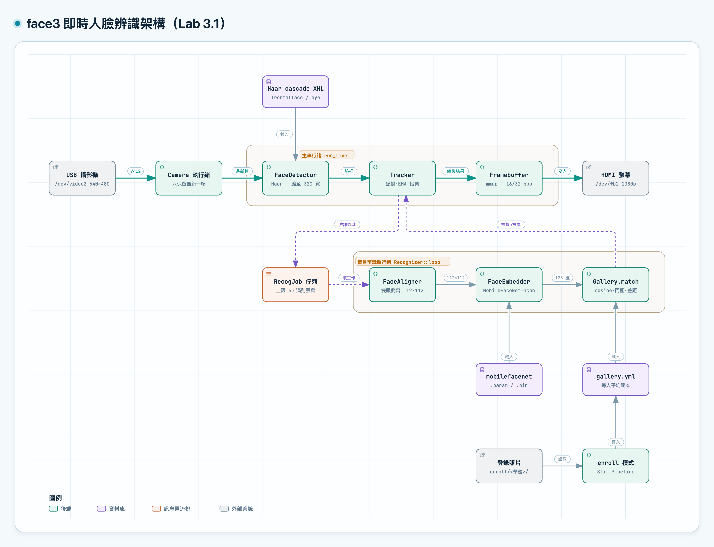

# Lab3-1  



## 總覽

我們的程式分成三條執行緒：**Camera 執行緒、主執行緒、背景辨識執行緒**。

```
USB 攝影機 ──V4L2──▶ [Camera 執行緒] ──swap/copyTo──▶ [主執行緒]
                                                      │ 偵測 → 追蹤
                                                      │ 剪臉、push(job) ──▶ [背景辨識執行緒]
                                                      │                         對齊 → MobileFaceNet → Gallery 比對
                                                      │ ◀── take_results() ──────┘
                                                      │ 投票 → 畫框 → fb.show()
                                                      ▼
                                                 /dev/fb2 → HDMI
```

| 交接點 | 從 → 到      | 交出的東西                                         | 方式                                                  |
| --- | ---------- | --------------------------------------------- | --------------------------------------------------- |
| ①   | Camera → 主 | 最新一幀 `cv::Mat` 640×480 BGR                    | `latest` + `wait_frame`（mutex + condition_variable） |
| ②   | 主 → 背景     | `RecogJob{track_id, region, face}`            | `recognizer.push`，佇列最多 4 個                          |
| ③   | 背景 → 主     | `RecogResult{track_id, label, score, millis}` | `results` + `take_results`（mutex，swap 整批取走）         |

主迴圈一輪的順序（`lab3/face/src/main.cpp:278-345`）：

```
wait_frame → detect → tracker.update → take_results / add_vote → resolve_duplicates
          → 送 RecogJob → draw_tracks → fb.show → read_key
```

所有參數都在 `config.yml`，改完重跑就好，不用重新編譯。

---

## 1. 取像（Camera 執行緒）

程式一開始用 `camera.open()` 打開 USB 攝影機，設成 MJPG、640×480。之後 Camera 執行緒在迴圈裡不斷用 `read()` 抓新的一幀。抓到後，它不把整張圖複製到共用區，而是在鎖裡用 `swap` 交換兩個 `cv::Mat` 的「指標」。這樣共用區永遠是最新的一幀，而且交換只花一瞬間，不會因為複製 900 KB 而卡住。主執行緒要用時，再把最新的那張複製一份到自己手上。

**開啟只做一次**：`/dev/video2`，用 MJPG 是因為 USB 2.0 頻寬塞不下未壓縮的 640×480 高幀率。

```cpp
// lab3/face/src/camera.cpp:7-22（節錄）
bool Camera::open ( int index, int width, int height )
{
    capture.open ( index );                         // index = 2 → /dev/video2（V4L2）
    ...
    capture.set ( cv::CAP_PROP_FOURCC, cv::VideoWriter::fourcc ( 'M', 'J', 'P', 'G' ) );
    capture.set ( cv::CAP_PROP_FRAME_WIDTH, width );    // 640
    capture.set ( cv::CAP_PROP_FRAME_HEIGHT, height );  // 480
    ...
}
```

**抓圖迴圈**：`read()` 會等 USB 傳來下一幀並把 JPEG 解碼成 BGR。真正的耗時都在鎖外面，鎖裡只做 `swap`（交換 Mat 標頭，O(1)）。

```cpp
// lab3/face/src/camera.cpp:41-61
void Camera::loop ( )
{
    cv::Mat frame;
    for ( ; ; )
    {
        {
            std::lock_guard<std::mutex> lock ( mtx );
            if ( !running ) return;                  // stop() 會把 running 設成 false
        }
        if ( !capture.read ( frame ) || frame.empty ( ) ) continue;
        struct timeval tv;
        gettimeofday ( &tv, NULL );     // 跟 main.cpp 的 now_seconds ( ) 用同一個時鐘
        {
            std::lock_guard<std::mutex> lock ( mtx );
            cv::swap ( latest, frame );     // 交換，不複製影像資料
            latest_time = tv.tv_sec + tv.tv_usec / 1000000.0;
            frame_id++;
        }
        cond.notify_all ( );            // 叫醒正在 wait_frame 的主執行緒
    }
}
```

**主執行緒取圖**：等到「比上次拿的更新的一幀」才回來；最多等 2 秒，好讓 Ctrl+C 能結束程式。拿的時候用 `copyTo` **深複製**，之後主執行緒在自己那份上畫框，Camera 執行緒同時 swap 也互不干擾。

```cpp
// lab3/face/src/camera.cpp:63-72
long Camera::wait_frame ( long last_id, cv::Mat &frame, double *captured_at )
{
    std::unique_lock<std::mutex> lock ( mtx );
    bool ok = cond.wait_for ( lock, std::chrono::seconds ( 2 ),
                              [&] { return !running || frame_id > last_id; } );
    if ( !ok || !running ) return -1;
    latest.copyTo ( frame );            // 深複製到主執行緒自己的 frame
    if ( captured_at ) *captured_at = latest_time;
    return frame_id;
}
```

> **為什麼要獨立一條 Camera 執行緒？** 如果主執行緒自己 `read()`，偵測 + 畫圖的時間內攝影機的幀會在驅動的緩衝區排隊，主執行緒拿到的永遠是「舊的」。獨立執行緒一直抓、只保留最新一幀，主執行緒每次拿到的都是最新畫面，延遲最低。

---

## 2. 偵測人臉（主執行緒）

主執行緒拿到畫面後，先轉灰階、縮到 320 寬、做直方圖等化，再用 Haar cascade 做多尺度偵測。找到的框換算回原圖座標，重疊太多的框合併成一個。

```cpp
// lab3/face/src/face_detector.cpp:42-69
std::vector<cv::Rect> FaceDetector::detect ( const cv::Mat &bgr )
{
    // 1. 轉灰階並縮小：Haar 只看亮度，縮小可以大幅減少運算量
    double scale = (double) detect_width / bgr.cols;      // 320 / 640 = 0.5
    if ( scale > 1.0 ) scale = 1.0;
    cv::Mat gray, small;
    cv::cvtColor ( bgr, gray, cv::COLOR_BGR2GRAY );
    cv::resize ( gray, small, cv::Size ( ), scale, scale, cv::INTER_AREA );

    // 2. 直方圖等化：降低光線明暗對偵測的影響
    cv::equalizeHist ( small, small );

    // 3. 多尺度偵測
    std::vector<cv::Rect> faces;
    cascade.detectMultiScale ( small, faces, scale_factor, min_neighbors,
                               cv::CASCADE_SCALE_IMAGE, cv::Size ( min_face, min_face ) );

    // 4. 座標換回原圖
    for ( size_t i = 0; i < faces.size ( ); i++ )
    {
        cv::Rect &r = faces[i];
        r = cv::Rect ( cvRound ( r.x / scale ), cvRound ( r.y / scale ),
                       cvRound ( r.width / scale ), cvRound ( r.height / scale ) );
    }

    // 5. Haar 會在不同縮放層級對同一張臉各給一個框（一大一小），合併成一個
    return merge_overlaps ( faces, overlap_merge );
}
```

**合併重疊框**：大框優先保留；小框跟已保留的框重疊面積超過「較小框面積的 60%」就丟掉。用「除以較小框」而不是 IoU，是為了抓到「大框包住小框」這種同一張臉的情況。

```cpp
// lab3/face/src/face_detector.cpp:22-40（節錄）
std::sort ( boxes.begin ( ), boxes.end ( ), /* 面積大的排前面 */ );
for ( ... )
{
    double inter = ( boxes[i] & kept[k] ).area ( );
    double smaller = std::min ( boxes[i].area ( ), kept[k].area ( ) );
    if ( smaller > 0 && inter / smaller > threshold ) duplicate = true;   // threshold = 0.6
}
```

相關參數：

```yaml
# lab3/face/config.yml:15-19
detect_width: 320            # downscale width before detection; lower = faster, misses small faces
scale_factor: 1.15           # image pyramid step; larger = faster, less accurate
min_neighbors: 4             # higher = fewer false boxes, more missed faces
min_face: 30                 # minimum face width in the downscaled image (pixels)
overlap_merge: 0.6           # two boxes overlapping more than this share of the smaller one = same face
```

**輸出**：`std::vector<cv::Rect>`，原圖（640×480）座標的臉框，回傳給 `tracker.update(faces, now)`。

---

## 3. 追蹤（主執行緒）

接著用 Tracker 把這一幀的框跟上一幀的框配對：大小差不到 2 倍，而且重疊（IoU ≥ 0.3）或中心距離不到一個臉寬，就認定是同一張臉。配不到的框就開一個新的 track。超過 0.4 秒都沒再被看到的 track 會被刪掉。

> Tracker **不看長相，只看位置**。「這是誰」交給第 5 步的辨識。

每張臉（track）記住的東西：

```cpp
// lab3/face/src/tracker.hpp:16-30（節錄）
struct Track
{
    int id = 0;
    cv::Rect2f box;                         // 平滑後的框（原圖座標）
    int hits = 0;                           // 累計被偵測到的幀數
    int missed = 0;                         // 連續沒被偵測到的幀數（> 0 時不送辨識）
    double last_seen = 0;                   // 最後一次被偵測到的時間（秒）
    std::deque<std::pair<int, float> > votes;   // 最近幾次辨識結果：(label, 相似度)
    int shown_label = LABEL_PENDING;        // 目前畫在畫面上的標籤
    double last_request = -1e9;             // 上次送去辨識的時間（秒）
    bool pending = false;                   // 是否有辨識工作還在背景執行

    bool visible ( int min_hits ) const { return hits >= min_hits; }
};
```

**配對條件**：

```cpp
// lab3/face/src/tracker.cpp:63-72
for ( size_t t = 0; t < list.size ( ); t++ )
    for ( size_t d = 0; d < detections.size ( ); d++ )
    {
        cv::Rect2f det ( detections[d] );
        float size_ratio = det.width / std::max ( list[t].box.width, 1.0f );
        if ( size_ratio < 0.5f || size_ratio > 2.0f ) continue;          // 大小差不到 2 倍
        float dist = center_distance ( list[t].box, det );
        if ( iou ( list[t].box, det ) >= iou_match || dist <= center_match ) // IoU ≥ 0.3 或中心距離 ≤ 1 臉寬
            pairs.push_back ( { dist, (int) t, (int) d } );
    }
```

候選組合依中心距離由近到遠排序，**一對一**配對（`tracker.cpp:74-81`），兩個人靠在一起也不會搶同一個框。

**配到 → 更新；沒配到 → 計數或刪除；多出來的框 → 新 track**：

```cpp
// lab3/face/src/tracker.cpp:87-94（配到的 track）
float alpha = pairs[i].distance > snap_distance ? 1.0f : ema_alpha;   // 小動作平滑，大動作直接跳
tr.box.x = alpha * det.x + ( 1 - alpha ) * tr.box.x;
...
tr.hits++;          // 累計，不會歸零
tr.missed = 0;
tr.last_seen = now;

// lab3/face/src/tracker.cpp:99-103（沒配到的 track）
if ( !track_used[t] ) list[t].missed++;
list.erase ( std::remove_if ( ..., [this, now] ( const Track &tr ) { return now - tr.last_seen > track_timeout; } ), ... );

// lab3/face/src/tracker.cpp:106-115（沒配到的偵測框）
Track tr;
tr.id = next_id++;
tr.box = cv::Rect2f ( detections[d] );
tr.hits = 1;
```

用「時間」（0.4 秒）而不是「幀數」判斷消失，FPS 高低都不影響：人走掉後舊框不會殘留好幾秒，偶爾漏偵測一幀框也不會閃掉。

---

## 4. 送去辨識（主執行緒 → 背景執行緒）

同一張臉累計被偵測到 2 次，而且這一幀確實有偵測到它，就把臉周圍多留 30% 的區域複製一份，打包成工作丟進佇列（最多 4 個）交給背景執行緒。之後同一張臉大約每 1 秒再送一次。主執行緒送完不等結果，繼續處理下一幀。

```cpp
// lab3/face/src/main.cpp:306-329
for ( size_t i = 0; i < tracks.size ( ); i++ )
{
    Track &tr = tracks[i];
    if ( !tr.visible ( cfg.min_hits ) || tr.pending || tr.missed > 0 ) continue;
    if ( now - tr.last_request < cfg.recog_interval ) continue;

    // 只複製臉附近（放大 1.6 倍）的區域，背景執行緒不會碰到正在被修改的整張影像
    cv::Rect face ( cvRound ( tr.box.x ), cvRound ( tr.box.y ), cvRound ( tr.box.width ), cvRound ( tr.box.height ) );
    int pad_x = face.width * 3 / 10, pad_y = face.height * 3 / 10;
    cv::Rect region ( face.x - pad_x, face.y - pad_y, face.width + 2 * pad_x, face.height + 2 * pad_y );
    region &= cv::Rect ( 0, 0, frame.cols, frame.rows );
    if ( region.area ( ) <= 0 ) continue;

    RecogJob job;
    job.track_id = tr.id;
    job.region = frame ( region ).clone ( );
    job.face = face - region.tl ( );
    if ( recognizer.push ( job ) )
    {
        tr.pending = true;
        tr.last_request = now;
    }
}
```

**送出的 4 個條件（全部成立才送）**：

| 條件 | 白話 | 為什麼 |
|---|---|---|
| `hits >= 2` | 累計偵測到 2 次（不必連續） | 濾掉只閃一幀的 Haar 誤判 |
| `missed == 0` | 這一幀確實有偵測到 | 沿用舊位置的框，底下可能已經沒有臉 |
| `!pending` | 上一次的結果已經回來 | 不重複送 |
| 距上次 ≥ 1 秒 | `last_request` 初值 `-1e9`，新臉立刻送 | 不用每幀都問 |

**打包的細節**：

- **多剪 30%**：Haar 的框有時偏小或偏移。多一圈，FaceAligner 找眼睛和旋轉時才有足夠的周圍畫面。
- **`.clone()`**：`frame(region)` 只是指向原圖的 ROI（淺複製）。主執行緒接著要在 `frame` 上畫框，不複製的話背景執行緒可能讀到畫了一半的線。複製後兩邊各用各的記憶體。
- **只剪一小塊**：約 200×200（約 120 KB），比整張 900 KB 省很多，佇列 4 格也不佔記憶體。
- **`face - region.tl()`**：把臉框從原圖座標換成小圖內的座標。

**佇列**：滿了就回傳 `false`，這次不送，`pending` 不設，下一幀再試。主執行緒永遠不會因為辨識太慢而卡住。

```cpp
// lab3/face/src/recognizer.cpp:31-40
bool Recognizer::push ( const RecogJob &job )
{
    {
        std::lock_guard<std::mutex> lock ( mtx );
        if ( jobs.size ( ) >= MAX_JOBS ) return false;    // MAX_JOBS = 4
        jobs.push ( job );
    }
    cond.notify_one ( );        // 叫醒背景執行緒
    return true;
}
```

---

## 5. 辨識（背景執行緒）

背景執行緒先做**對齊**：用眼睛的 Haar cascade 找到兩隻眼睛，透過旋轉、等比例縮放、平移，把兩眼移到 ArcFace 樣板規定的位置，輸出 112×112 的正臉。接著丟進 **MobileFaceNet**（用 ncnn 執行），得到一條 **128 維、長度正規化成 1 的特徵向量**。
這條向量會跟 enroll 時建立的每位組員的代表向量算 **cosine 相似度**。最高分 ≥ 0.45，而且比第二高多 0.08 以上，才判定是那位組員，否則就是 **unknown**。

**背景執行緒的迴圈**：沒工作就睡，有工作就拿出來，**在鎖外面**做最花時間的對齊、推論、比對（約 180 ms），做完再進鎖放結果。

```cpp
// lab3/face/src/recognizer.cpp:50-79（節錄）
void Recognizer::loop ( )
{
    for ( ; ; )
    {
        RecogJob job;
        {
            std::unique_lock<std::mutex> lock ( mtx );
            cond.wait ( lock, [this] { return stopping || !jobs.empty ( ); } );
            if ( stopping ) return;
            job = jobs.front ( );
            jobs.pop ( );
        }

        cv::Mat aligned = aligner.align ( job.region, job.face );          // 5a. 對齊
        std::vector<float> feature = embedder.embed ( aligned );           // 5b. 128 維特徵
        MatchResult m = gallery->match ( feature, threshold, margin );     // 5c. 比對

        RecogResult r;
        r.track_id = job.track_id;
        r.label = m.index >= 0 ? m.index : LABEL_UNKNOWN;
        r.score = m.best;
        ...
        {
            std::lock_guard<std::mutex> lock ( mtx );
            results.push_back ( r );
        }
    }
}
```

### 5a. 對齊（FaceAligner）

**找眼睛**：只在臉框上半部（60%）找，左右兩半各取面積最大的候選，再做合理性檢查。找不到的話，用臉框的固定比例猜（x 在 30% / 70%，y 在 38%）。

```cpp
// lab3/face/src/face_aligner.cpp:31, 41, 64-67（節錄）
cv::Rect upper ( face.x, face.y, face.width, face.height * 6 / 10 );
eye_cascade.detectMultiScale ( gray, eyes, 1.1, 3, cv::CASCADE_SCALE_IMAGE, cv::Size ( min_eye, min_eye ) );
...
// 合理性檢查：兩眼距離要在臉寬的 25%–65% 之間，傾斜不能超過約 25 度
if ( dx < face.width * 0.25f || dx > face.width * 0.65f ) return false;
if ( std::fabs ( dy ) > dx * 0.47f ) return false;
```

**相似變換到 ArcFace 樣板**：MobileFaceNet 訓練時每張臉的兩眼都在這兩個固定點，送進去的臉也必須一樣，特徵才準。

```cpp
// lab3/face/src/face_aligner.cpp:8-10
static const cv::Point2f TEMPLATE_LEFT_EYE ( 38.2946f, 51.6963f );
static const cv::Point2f TEMPLATE_RIGHT_EYE ( 73.5318f, 51.5014f );
static const int ALIGNED_SIZE = 112;

// lab3/face/src/face_aligner.cpp:82-97（節錄）
double scale = std::sqrt ( dst.dot ( dst ) / src.dot ( src ) );               // 兩眼距離縮放到樣板的 35.2 px
double angle = std::atan2 ( dst.y, dst.x ) - std::atan2 ( src.y, src.x );     // 兩眼連線轉成水平
double a = scale * std::cos ( angle ), b = scale * std::sin ( angle );
double tx = TEMPLATE_LEFT_EYE.x - ( a * left.x - b * left.y );              // 左眼對到樣板左眼
double ty = TEMPLATE_LEFT_EYE.y - ( b * left.x + a * left.y );
cv::Mat M = ( cv::Mat_<double> ( 2, 3 ) << a, -b, tx, b, a, ty );
cv::warpAffine ( bgr, aligned, M, cv::Size ( ALIGNED_SIZE, ALIGNED_SIZE ),
                 cv::INTER_LINEAR, cv::BORDER_REPLICATE );
```

> **為什麼一定是 112×112？** MobileFaceNet 經過 16 倍下採樣後是 7×7 特徵圖，最後的 GDConv kernel 剛好是 7×7，把它壓成 1×1。輸入尺寸不同，輸出形狀就不對。

### 5b. 特徵（FaceEmbedder + ncnn）

開發板的 OpenCV 3.4 沒有編進 dnn 模組，所以用 **ncnn** 跑 MobileFaceNet。正規化 `(x - 127.5) × 0.0078125` 已經寫在模型的第一層，程式不用自己減平均值。

```cpp
// lab3/face/src/face_embedder.cpp:27-46（節錄）
int type = input_rgb ? ncnn::Mat::PIXEL_BGR2RGB : ncnn::Mat::PIXEL_BGR;
ncnn::Mat in = ncnn::Mat::from_pixels ( aligned_bgr.data, type, aligned_bgr.cols, aligned_bgr.rows );

ncnn::Extractor ex = net.create_extractor ( );
ex.input ( input_blob.c_str ( ), in );       // "data"
ncnn::Mat out;
ex.extract ( output_blob.c_str ( ), out );   // "fc1" → 128 維

ncnn::Mat flat = out.reshape ( out.w * out.h * out.c );
std::vector<float> feature ( flat.w );       // 長度由模型決定，程式沒有寫死 128
...
l2_normalize ( feature );                    // 長度變成 1
```

> **128 維不是 128 個類別**。它是描述一張臉的「座標」，每一格本身沒有意義；同一人的兩條向量方向接近，不同人方向差很多。「是誰」由下一步跟 Gallery 比對決定。

### 5c. 比對（Gallery）

兩條向量都已經正規化成長度 1，所以 cosine 相似度就等於內積：

```cpp
// lab3/face/src/face_embedder.cpp:57-63
float cosine_similarity ( const std::vector<float> &a, const std::vector<float> &b )
{
    double dot = 0;
    size_t n = std::min ( a.size ( ), b.size ( ) );
    for ( size_t i = 0; i < n; i++ ) dot += (double) a[i] * b[i];
    return (float) dot;
}
```

跟每位組員的代表向量比，記下最高分和第二高分：

```cpp
// lab3/face/src/gallery.cpp:79-100（節錄）
for ( size_t i = 0; i < persons.size ( ); i++ )
{
    float s = cosine_similarity ( embedding, persons[i].mean );
    if ( s > result.best ) { result.second = result.best; result.best = s; best_index = (int) i; }
    else if ( s > result.second ) result.second = s;
}
if ( best_index >= 0 && result.best >= threshold && result.best - result.second >= margin )
    result.index = best_index;          // 否則維持 -1 → unknown
```

```yaml
# lab3/face/config.yml:31-32
sim_threshold: 0.45          # cosine similarity below this -> unknown (calibrate with enroll/score)
sim_margin: 0.08             # best - second below this -> unknown
```

| 情況 | label | 顯示 |
|---|---|---|
| best ≥ 0.45 且 best − second ≥ 0.08 | Gallery 中的順序（0、1…） | 學號 |
| 跟誰都不夠像，或兩人差不多像 | `LABEL_UNKNOWN = -1` | unknown |
| 還沒有結果 | `LABEL_PENDING = -2` | `...` |

（`lab3/face/src/tracker.hpp:8-14`）

---

## 6. 顯示（主執行緒）

辨識結果回來後，第一次的結果會直接顯示，讓名字盡快出現；之後的結果先放進該張臉的投票視窗（最近 7 次），新的答案至少 3 票、而且比目前顯示的答案票數多，才換上新名字，避免名字跳來跳去。最後主執行緒在當前這一幀畫上框和學號，再用 Lab2 寫好的 framebuffer 方式，把畫面寫進 `/dev/fb2`，顯示到 HDMI 上。

**收結果**：用 `swap` 一次把整批結果取走，鎖只握一瞬間。

```cpp
// lab3/face/src/recognizer.cpp:42-48
std::vector<RecogResult> Recognizer::take_results ( )
{
    std::lock_guard<std::mutex> lock ( mtx );
    std::vector<RecogResult> out;
    out.swap ( results );
    return out;
}
```

**投票 + 遲滯**：

```cpp
// lab3/face/src/tracker.cpp:148-176（節錄）
tr->pending = false;                                   // 結果回來了，可以再送下一次
tr->votes.push_back ( std::make_pair ( label, score ) );
while ( (int) tr->votes.size ( ) > vote_window ) tr->votes.pop_front ( );   // 只留最近 7 次

if ( tr->shown_label == LABEL_PENDING ) { tr->shown_label = label; return; } // 第一次直接顯示

// 多數決 + 遲滯：新的標籤至少要 vote_min 票，而且票數多於目前顯示的標籤，才換掉
...
if ( top_label != tr->shown_label && top_count >= vote_min ) tr->shown_label = top_label;
```

**去重複**：兩個框同時顯示同一位組員時，平均相似度低的那個改成 unknown（`tracker.cpp:178-196`）。同一個人不可能同時出現在兩個地方。

**畫到螢幕**：`draw_tracks` 直接畫在主執行緒自己的 `frame` 上（`main.cpp:217-238`），然後 `fb.show`。在 mmap 出來的 framebuffer 記憶體上直接建一個 `cv::Mat`，`cvtColor` 的結果就直接寫進螢幕，不用另外 memcpy。

```cpp
// lab3/face/src/framebuffer.cpp:115-120
// 直接在 framebuffer 記憶體上建立一個 Mat（置中的那一塊），轉色時結果直接寫進螢幕，
// 不需要先轉到暫存影像再一列一列 memcpy
const int x_offset = ( xres - w ) / 2;
const int y_offset = ( yres - h ) / 2;
cv::Mat screen ( h, w, type, mem + y_offset * line_length + x_offset * ( bits_per_pixel / 8 ), line_length );
convert ( shown, screen );      // 32 bpp → BGR2BGRA / BGR2RGBA
```

```yaml
# lab3/face/config.yml:8-9
fb_device: "/dev/fb2"        # fb2 = HDMI 1920x1080 @ 32 bpp; fb0 = 7" LCD
display_fit: 0               # 0 = show the camera image at its own size, centered (fast)
```

`display_fit: 0` 讓 640×480 置中顯示、不放大，每幀寫入的資料從約 6 MB 降到約 1.2 MB。

---

## 附：Enroll（建立 Gallery）

至於 enroll，也是用同一套「偵測 → 對齊 → MobileFaceNet」，只是輸入換成照片檔。每位組員所有照片的向量取平均後存進 `gallery.yml`，作為比對的基準。

```cpp
// lab3/face/src/main.cpp:44-66（節錄）
struct StillPipeline
{
    FaceDetector detector;   // 跟即時辨識同一個 Haar 偵測
    FaceAligner aligner;     // 同一個對齊
    FaceEmbedder embedder;   // 同一個 MobileFaceNet

    bool process ( const cv::Mat &image, std::vector<float> &feature, cv::Mat &aligned, bool &eyes_found )
    {
        std::vector<cv::Rect> faces = detector.detect ( image );
        if ( faces.empty ( ) ) return false;
        cv::Rect largest = /* 面積最大的臉 */;
        aligned = aligner.align ( image, largest, &eyes_found );
        feature = embedder.embed ( aligned );
        return true;
    }
};
```

- **label 就是資料夾名稱**：`photos/0812345/3.jpg` → `0812345`（`main.cpp:84-90`）。
- **每人取平均**：`gallery.cpp:23-35` 把同一人所有向量相加後再正規化，得到代表向量 `mean`。
- **檢查對齊**：每張對齊後的 112×112 會存到 `aligned/<label>/`，可以打開確認兩眼是否水平、置中（`main.cpp:126-127`）。
- **一定要用同一套**：換模型或換對齊方式，向量就不在同一個座標系，Gallery 必須重新 enroll。
