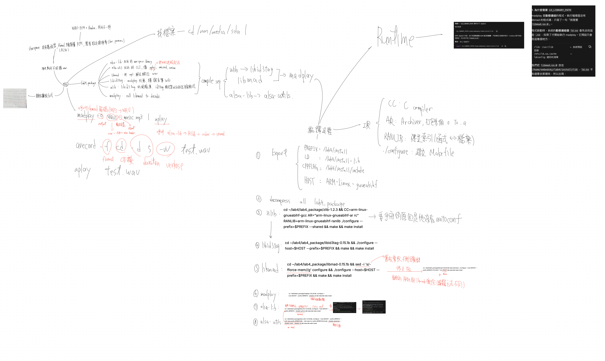

# Lab 4：在 E9V3 上建置 MP3 播放器

- 組別：30
- 組員：314581047、314831017

## MindMap


## 一、實驗目標與環境

本實驗只使用課程提供的六個原始碼套件（不使用 apt-get），在 Ubuntu 上交叉編譯出 madplay 與 aplay，再到 E9V3 開發板上播放 `music.mp3`，並用麥克風錄製 `.wav` 檔後回放。

| 項目 | 內容 |
| --- | --- |
| 開發板 | Embedsky E9V3（TQIMX6Q，ARM Cortex-A9） |
| 交叉編譯器 | gcc-linaro-5.3-2016.02-x86_64_arm-linux-gnueabihf（位於 `/opt/EmbedSky/`，指令前綴為 `arm-linux-gnueabihf-`） |
| 原始碼套件 | zlib-1.2.3、libid3tag-0.15.1b、libmad-0.15.1b、madplay-0.15.2b、alsa-lib-1.0.26、alsa-utils-1.0.26 |

## 二、問題分析

### 2.1 為什麼板子原本無法播放音訊

板子上已經有 ALSA 音效卡驅動，但它只存在於核心（kernel space）。驅動只提供 `/dev/snd/pcmC0D0p` 這類裝置檔，並且只接受原始 PCM 樣本。它不會解析 WAV 或 MP3 的檔案格式，也不會自己決定取樣率與聲道數。

要播放聲音，使用者空間（user space）必須有程式依序完成以下工作：

1. 讀取並解析音訊檔案。如果是 MP3，還要先解碼成 PCM。
2. 開啟 PCM 裝置，透過 ioctl 設定硬體參數（格式、聲道、取樣率、buffer 大小）。
3. 持續把 PCM 樣本寫進驅動。

板子上原本沒有任何程式或函式庫在做這些事，所以連不需要解碼的 `.wav` 都無法播放。我們沒辦法直接執行 `cat a.wav > /dev/snd/pcmC0D0p`，因為 ALSA 的 PCM 裝置必須先透過 ioctl 設定好參數，才會接收資料。

### 2.2 各元件的角色

| 元件 | 所在層級 | 作用 |
| --- | --- | --- |
| ALSA 驅動 | 核心 | 驅動音效晶片（codec），提供 `/dev/snd/*`，用 DMA 把 PCM 送到硬體。板子原本就有。 |
| alsa-lib（libasound） | 使用者空間函式庫 | 提供 `snd_pcm_open()`、`snd_pcm_writei()` 等 API，並把它們轉成 ioctl。也負責讀取 `alsa.conf` 設定檔。 |
| alsa-utils | 使用者空間程式 | 提供 `aplay`（播放 WAV）、`arecord`（錄音）、`amixer`（調整音量與靜音）。 |
| libmad | 使用者空間函式庫 | MPEG 音訊解碼器，以定點數運算把 MP3 解成 PCM。 |
| libid3tag | 使用者空間函式庫 | 讀取 MP3 的 ID3 標籤。編譯 madplay 時必須有它。 |
| zlib | 使用者空間函式庫 | 壓縮函式庫，libid3tag 需要它來處理壓縮過的 ID3v2 frame。 |
| madplay | 使用者空間程式 | 呼叫 libmad 解碼 MP3，輸出 WAV 串流。 |

aplay 只能播放 WAV，不能解碼 MP3；madplay 負責解碼 MP3。因此本實驗用 pipe 把兩者串起來：

```
madplay -o wav:- music.mp3 | aplay
```

## 三、編譯方式與重點

### 3.1 我們怎麼編譯：交叉編譯 + autotools

開發機是 x86_64 的 Ubuntu，板子是 ARM Cortex-A9。在 Ubuntu 上直接用 `gcc` 編出來的是 x86 機器碼，放到板子上會出現 `Exec format error`，無法執行。因此我們用交叉編譯器 `arm-linux-gnueabihf-gcc`：它在 x86 上執行，產生的卻是 ARM 機器碼，並且連結 toolchain 內附的 ARM 版 glibc。

六個套件中，除了 zlib 以外都使用 GNU autotools，編譯固定分成三個步驟：

| 步驟 | 做什麼 | 本實驗用到的關鍵參數 |
| --- | --- | --- |
| `./configure` | 偵測編譯環境、檢查相依的標頭檔與函式庫是否存在，產生 `Makefile` 與 `config.h` | `--host=arm-linux-gnueabihf`：程式要在 ARM Linux 上執行，因此改用 `arm-linux-gnueabihf-` 開頭的工具；`--prefix`：安裝位置 |
| `make` | 依照 `Makefile` 編譯、連結 | 無 |
| `make install` | 把執行檔、函式庫、標頭檔、設定檔複製到 `--prefix` 底下的 `bin/`、`lib/`、`include/`、`share/` | 無 |

`--build` 是「編譯時所在的機器」，`--host` 是「程式要在哪台機器執行」，兩者不同就是交叉編譯。configure 會自動偵測 `--build`，所以每次都會出現 `If you wanted to set the --build type, don't use --host` 這個警告，可以忽略。zlib 的 configure 是手寫的，不認得 `--host`，只能用 `CC=`、`AR=`、`RANLIB=` 直接指定交叉編譯工具。

### 3.2 為什麼要有編譯順序

函式庫之間有相依關係。後面的套件在 configure 時會檢查前面套件的標頭檔與函式庫是否存在，在 make 時要連結它們的 `.so`。如果前面的套件還沒裝好，configure 會直接報錯停止，例如找不到 `mad.h` 或 `-lmad`。

```
zlib --> libid3tag --+
                     +--> madplay
libmad --------------+

alsa-lib --> alsa-utils (aplay / arecord / amixer)
```

| 順序 | 套件 | 需要先有 | 原因 |
| --- | --- | --- | --- |
| 1 | zlib | 無 | 最底層的壓縮函式庫 |
| 2 | libid3tag | zlib | ID3v2 標籤裡的 frame 可能經過壓縮，需要 zlib 解壓 |
| 3 | libmad | 無 | 純粹的解碼函式庫，只要排在 madplay 之前即可 |
| 4 | madplay | libmad、libid3tag | 用 libmad 解碼、用 libid3tag 讀標籤，兩者缺一 configure 都會失敗 |
| 5 | alsa-lib | 無 | ALSA 的使用者空間函式庫 |
| 6 | alsa-utils | alsa-lib | aplay、arecord、amixer 都是透過 alsa-lib 的 API 操作音效卡 |

madplay 和 alsa-utils 這兩條線彼此獨立。madplay 只負責把 MP3 解成 WAV 串流寫到 stdout，不直接呼叫 ALSA，所以兩條線誰先編都可以，但每條線內部的順序不能顛倒。

相依關係在執行時同樣存在：板子上必須同時有這些 `.so` 檔，程式才能啟動。所以部署時要把整個 `lib/` 一起帶上去，並用 `LD_LIBRARY_PATH` 告訴動態連結器去哪裡找。

### 3.3 編譯要注意的重點

1. **每個套件都必須用交叉編譯器。** 只要有一個套件不小心用了主機的 `gcc`，連結時就會出現架構不符的錯誤，或是放到板子上無法執行。編譯完用 `file` 檢查，結果要是 `ARM, EABI5`，不能是 `x86-64`。
2. **統一安裝到自己的 prefix，不要用 sudo 裝進系統目錄。** 這些是 ARM 程式，裝進 Ubuntu 的 `/usr` 會混進主機的系統。全部集中在 `$HOME/lab4/install`，後面的套件容易找到前面的套件，打包到板子上也只要帶這一個資料夾。
3. **讓後面的套件找得到前面的套件。** 用 `CPPFLAGS=-I$PREFIX/include`、`LDFLAGS=-L$PREFIX/lib` 指定搜尋路徑，alsa-utils 另外用 `--with-alsa-prefix`、`--with-alsa-inc-prefix` 指定 alsa-lib 的位置。否則 configure 可能找不到，或是誤用 Ubuntu 主機上 x86 版的函式庫。
4. **prefix 會被寫死進程式。** alsa-lib 會把設定檔路徑 `$PREFIX/share/alsa/alsa.conf` 寫進函式庫。板子上的放置路徑必須和編譯時的 prefix 一致，否則要用 symlink 接過去（見問題 6）。
5. **舊套件和新編譯器可能不相容。** 這些套件大多是 2004 年左右的版本，而 toolchain 是 2016 年的 gcc 5.3。本實驗遇到三個相關問題：gcc 已移除的 `-fforce-mem` 參數、預設 Thumb-2 模式不支援 libmad 的 ARM 組合語言（見問題 2）、alsa-lib 猜錯交叉編譯器名稱（見問題 3）。
6. **失敗後重新 configure 前先 `make distclean`。** 清掉上一次留下的設定與 `.o` 檔，避免新舊參數混在一起。
7. **環境變數只在目前的 shell 有效。** 不管是 Ubuntu 上的 `PREFIX`、`CPPFLAGS`，還是板子上的 `LD_LIBRARY_PATH`，開新的 terminal 都要重新 `export`（見問題 5）。
8. **板子上只需要執行時期的檔案。** 板子只需要 `bin/`、`lib/`、`share/alsa/`；`include/` 和 `.a` 靜態函式庫只有編譯時才會用到。

## 四、建置步驟

編譯都在 Ubuntu 虛擬機上進行。原因是交叉編譯器安裝在 Ubuntu 上，而且這些 2000 年代的 autotools 套件在 Linux 上編譯比較順利。

### 4.1 設定環境變數

```
export PREFIX=$HOME/lab4/install HOST=arm-linux-gnueabihf \
       CPPFLAGS="-I$HOME/lab4/install/include" LDFLAGS="-L$HOME/lab4/install/lib"
```

- `PREFIX`：所有產物都安裝到同一個目錄。這樣不會把 ARM 程式裝進 Ubuntu 的系統目錄，之後打包也比較方便。
- `HOST`：告訴 configure 目標平台是 ARM Linux，這是開啟交叉編譯的開關。
- `CPPFLAGS` / `LDFLAGS`：讓後面的套件可以找到前面已安裝的標頭檔與函式庫。

### 4.2 解壓縮

```
cd ~/lab4/lab4_package
for f in *.tar.gz; do tar xzf "$f"; done
for f in *.tar.bz2; do tar xjf "$f"; done
```

### 4.3 zlib

```
cd zlib-1.2.3
CC=arm-linux-gnueabihf-gcc AR="arm-linux-gnueabihf-ar rc" \
RANLIB=arm-linux-gnueabihf-ranlib ./configure --prefix=$PREFIX --shared
make && make install
```

zlib 的 configure 是手寫的，不支援 `--host`，所以要直接用 `CC`、`AR`、`RANLIB` 指定交叉編譯工具。

### 4.4 libid3tag

```
cd ../libid3tag-0.15.1b
./configure --host=$HOST --prefix=$PREFIX
make && make install
```

### 4.5 libmad

```
cd ../libmad-0.15.1b
sed -i 's/-fforce-mem//g' configure
./configure --host=$HOST --prefix=$PREFIX CFLAGS="-O2 -marm"
make && make install
```

- `-fforce-mem` 是舊版 gcc 的參數，gcc 4.3 以後已經移除，必須從 configure 中刪掉。
- `-marm` 的原因請見第五節的問題 1。

### 4.6 madplay

```
cd ../madplay-0.15.2b
./configure --host=$HOST --prefix=$PREFIX --disable-nls
make && make install
```

`--disable-nls` 會關閉多國語言翻譯，避免需要額外的 gettext 函式庫。

### 4.7 alsa-lib

```
cd ../alsa-lib-1.0.26
./configure --host=$HOST --prefix=$PREFIX --disable-python CC=arm-linux-gnueabihf-gcc
make && make install
```

- 不需要 Python 綁定，所以用 `--disable-python` 關掉。
- `CC=` 的原因請見第五節的問題 2。

### 4.8 alsa-utils

```
cd ../alsa-utils-1.0.26
./configure --host=$HOST --prefix=$PREFIX CC=arm-linux-gnueabihf-gcc \
  --with-alsa-prefix=$PREFIX/lib --with-alsa-inc-prefix=$PREFIX/include \
  --disable-alsamixer --disable-xmlto --disable-nls
make
make install udevrulesdir=$PREFIX/lib/udev/rules.d
```

- `--with-alsa-*`：指定使用剛剛編好的 ARM 版 alsa-lib，而不是 Ubuntu 系統上的 x86 版。
- `--disable-alsamixer`：alsamixer 需要 ncurses，而且 `amixer` 已經足夠使用。
- `--disable-xmlto`：不產生 man page 文件。
- `udevrulesdir=` 的原因請見第五節的問題 3。

### 4.9 驗證與打包

```
file $PREFIX/bin/madplay $PREFIX/bin/aplay $PREFIX/lib/libmad.so.0 $PREFIX/lib/libasound.so.2
cd ~/lab4 && tar czf lab4_board.tar.gz -C install bin lib share
```

`file` 指令的結果應該顯示 `ELF 32-bit LSB ... ARM, EABI5`，表示這些檔案確實是 ARM 版本。打包時只需要 `bin`（執行檔）、`lib`（共享函式庫）、`share/alsa`（alsa-lib 設定檔）三個目錄，`include` 只有編譯時才用得到。

## 五、遇到的問題與解決方法

### 問題 1：libmad 編譯時組譯器報錯（Thumb mode）

**錯誤訊息：**

```
Error: selected processor does not support Thumb mode `rsc r7,r7,#0'
make[2]: *** [synth.lo] Error 1
```

**原因：** configure 偵測到目標平台是 ARM，因此啟用了 `FPM_ARM`，也就是在 `fixed.h` 中使用 ARM 組合語言加速定點數乘法。但 linaro gcc 5.3 預設產生 Thumb-2 指令，而 `rsc`（reverse subtract with carry）在 Thumb-2 中不存在，所以組譯失敗。

**解法：** 先執行 `make distclean`，再用 `CFLAGS="-O2 -marm"` 重新 configure，強制 libmad 以 ARM 模式編譯。這樣可以保留組合語言的加速效果。Cortex-A9 同時支援 ARM 與 Thumb 指令集，兩種模式的程式碼可以混用。另一個替代方案是 `--enable-fpm=default`，改用純 C 的定點數運算。

### 問題 2：alsa-lib configure 失敗（C compiler cannot create executables）

**錯誤訊息：**

```
checking for cross-compiler... arm-arm-unknown-linux-gnueabihf-gcc
configure: error: C compiler cannot create executables
```

**原因：** alsa-lib 1.0.26 的 configure 會自己推測交叉編譯器的名稱，方式是把「CPU 名稱」和「正規化後的完整 host 名稱」接起來，結果得到不存在的 `arm-arm-unknown-linux-gnueabihf-gcc`。

**解法：** 用 `CC=arm-linux-gnueabihf-gcc` 明確指定編譯器。alsa-utils 也加上同樣的參數，避免發生相同的問題。

### 問題 3：alsa-utils 執行 make install 時 Permission denied

**錯誤訊息：**

```
/usr/bin/install -c -m 644 90-alsa-restore.rules '/lib/udev/rules.d'
/usr/bin/install: cannot remove '/lib/udev/rules.d/90-alsa-restore.rules': Permission denied
```

**原因：** 編譯本身已經成功。但 alsactl 的 udev 規則檔安裝路徑寫死為 `/lib/udev/rules.d`，不會跟著 `--prefix` 改變，而一般使用者沒有寫入這個系統目錄的權限。

**解法：** 不使用 sudo，因為那樣會把 ARM 版本的設定檔寫進 Ubuntu 主機。改成在 make 時覆蓋 Makefile 變數：`make install udevrulesdir=$PREFIX/lib/udev/rules.d`。這樣不需要重新 configure 或重新編譯。

### 問題 4：板子上執行 madplay 找不到 libmad.so.0

**錯誤訊息：**

```
madplay: error while loading shared libraries: libmad.so.0: cannot open shared object file: No such file or directory
```

**原因：** 設定函式庫路徑時只打了 `LD_LIBRARY_PATH=/home/embedsky/lab4/install/lib`，沒有加 `export`。沒有 export 的變數只存在於目前的 shell，不會傳給 shell 啟動的子程序，所以 madplay 的動態連結器（ld.so）看不到這個路徑，在系統預設的 `/lib`、`/usr/lib` 中也找不到 `libmad.so.0`。

**解法：** 改用 `export LD_LIBRARY_PATH=/home/embedsky/lab4/install/lib`。

### 問題 5：部署路徑與編譯時的 prefix 不同

**原因：** 編譯時的 `--prefix` 是 Ubuntu 上的 `/home/ubuntu/lab4/install`，但板子上的使用者目錄是 `/home/embedsky`，檔案實際放在 `/home/embedsky/lab4/install`。共享函式庫可以用 `LD_LIBRARY_PATH` 指定位置，但 alsa-lib 的設定檔路徑在編譯時已經寫死成 `/home/ubuntu/lab4/install/share/alsa/alsa.conf`。放在別的地方，aplay 會找不到 ALSA 的設定。

**解法：** 在板子上建立 symlink，讓編譯時寫死的路徑指到實際的位置，不需要重新編譯：

```
mkdir -p /home/ubuntu/lab4
ln -s /home/embedsky/lab4/install /home/ubuntu/lab4/install
```

## 六、上板執行

### 5.1 播放 MP3（Demo 2.1）

```
madplay --version
aplay -l
madplay -o wav:- music.mp3 | aplay
```

- `madplay --version`：確認執行檔和共享函式庫都能正確載入。
- `aplay -l`：確認系統有偵測到音效卡。
- 最後一行用 madplay 把 MP3 解碼成 WAV 串流，再透過 pipe 交給 aplay 播放。實測可以從耳機孔正常聽到音樂。

### 5.2 錄音與回放（Demo 2.2）

```
arecord -l
amixer scontrols
arecord -f cd -d 5 test.wav
aplay test.wav
```

`-f cd` 表示 16-bit、44100 Hz、雙聲道；`-d 5` 表示錄 5 秒。錄好的 WAV 不需要解碼，可以直接用 aplay 播放。如果錄到的是一片無聲，要用 `amixer` 開啟麥克風的 Capture 開關。

## 七、MP3 播放的訊號處理流程

MP3 是經過心理聲學模型去除人耳聽不到的成分，再以 Huffman 編碼壓縮的頻域資料。播放 MP3 就是把這個過程反過來，還原成時域的 PCM 樣本，再交給硬體轉成類比訊號。完整流程如下：

```
music.mp3
  |
  | (1) madplay 讀檔，把資料一塊一塊餵給 libmad
  v
[ libmad ]
  (2) 尋找 frame 同步字，解析 header（位元率、取樣率、聲道模式）
  (3) Huffman 解碼，得到量化後的頻譜係數
  (4) 反量化（requantize），還原頻譜係數的大小
  (5) 立體聲處理（M/S stereo、intensity stereo）
  (6) 混疊消除（alias reduction）
  (7) IMDCT：頻域轉回時域，再做重疊相加（overlap-add）
  (8) 多相合成濾波器組（polyphase synthesis filterbank）輸出 PCM
  |
  |  定點數 PCM（mad_fixed_t，約 28-bit 精度）
  v
[ madplay ]
  (9)  縮減為 16-bit 樣本（捨入或 dither）
  (10) 加上 WAV header，寫到 stdout
  |
  |  pipe
  v
[ aplay ]
  (11) 從 stdin 讀取 WAV header，取得 44100 Hz、雙聲道、S16_LE 等資訊
  (12) 開啟 "default" 裝置，設定 hw_params
  (13) 迴圈：讀一塊 PCM，呼叫 snd_pcm_writei() 寫出
  v
[ alsa-lib ]
  (14) 讀取 alsa.conf，把 "default" 解析為實際的硬體裝置
  (15) 硬體不支援該格式時，由 plug 外掛進行格式或取樣率轉換
  (16) 把 API 呼叫轉成 ioctl（HW_PARAMS、PREPARE、WRITEI_FRAMES）
  |
  ======== user space / kernel space ========
  v
[ ALSA 核心驅動 ]
  (17) 把 PCM 樣本放進 ring buffer
  (18) DMA 把資料經 I2S 送到 codec；每播完一個 period 就發出中斷，通知可以繼續寫入
  v
[ codec 晶片 ]
  (19) DAC 把數位樣本轉成類比電壓，經耳機放大器輸出到耳機孔
  v
喇叭 / 耳機
```

錄音則是反方向：麥克風 → codec 的 ADC → I2S / DMA → ALSA 驅動 → alsa-lib → arecord 加上 WAV header → `.wav` 檔。

## 八、參考資料

1. Underbit Technologies, *MAD: MPEG Audio Decoder*. https://www.underbit.com/products/mad/
2. ALSA Project, *Advanced Linux Sound Architecture*. https://www.alsa-project.org/
3. ALSA Project, *ALSA library API reference*. https://www.alsa-project.org/alsa-doc/alsa-lib/
4. ISO/IEC 11172-3:1993, *Coding of moving pictures and associated audio — Part 3: Audio*.
5. OpenSSH 9.0 Release Notes（scp 預設改用 SFTP 協定）. https://www.openssh.com/txt/release-9.0
6. Free Software Foundation, *GNU Make Manual — Overriding Variables*. https://www.gnu.org/software/make/manual/make.html#Overriding
7. Arm Ltd., *ARM Architecture Reference Manual, ARMv7-A and ARMv7-R edition*（RSC 指令與 Thumb-2 指令集）.
8. 本課程 Lab 4 講義（115_lab4.pdf）.
